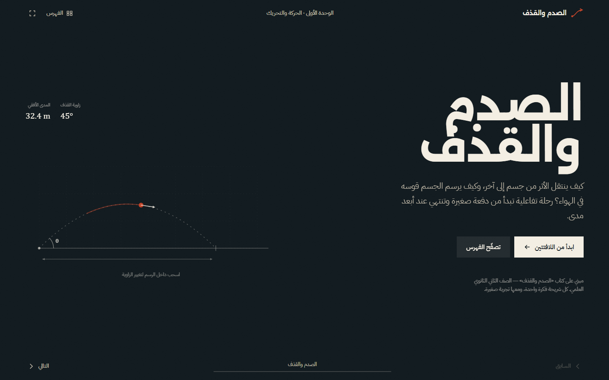

# الصدم والقذف — رحلة تفاعلية

تطبيق ويب تعليمي عربي (RTL) يشرح كمية الحركة، والتصادمات المرنة والليّنة، وحركة القذائف، مبني على كتاب **«الصدم والقذف»** للصف الثاني الثانوي العلمي. يتكوّن من **55 شريحة**، كل شريحة فكرة واحدة، ومعها تجربة أو سؤال.



**الرابط المباشر:** https://enderknght159.github.io/physics-3d/

## التشغيل

لا يحتاج التطبيق إلى تثبيت أو اتصال بالإنترنت:

- افتح `index.html` مباشرة في متصفح حديث، أو
- شغّل خادماً محلياً من هذا المجلد:

```bash
python -m http.server 8000
```

ثم افتح `http://localhost:8000`.

## التحكم

- الأسهم: `←` أو `↓` أو `Space` للشريحة التالية، `→` أو `↑` للسابقة.
- `O` لفتح الفهرس، `F` لملء الشاشة، `Home` / `End` للبداية والنهاية، `Esc` لإغلاق الشرح أو الفهرس.
- على الجوال: اسحب أفقياً للتنقل، ومرّر عمودياً داخل الشريحة الطويلة.
- المصطلحات التي تحتها خط منقّط تفتح شرحاً إضافياً عند النقر أو المرور.
- الأشرطة والمنزلقات والأسئلة كلها تعمل باللمس ولوحة المفاتيح.
- يمكن الرجوع إلى أي شريحة من الفهرس في الشريط العلوي.

## المحتوى

**مدخل**

- خريطة الرحلة، وفكرتان كبيرتان.

**الدرس الأول — كمية الحركة وتطبيقاتها**

- لغز اللافتتين، ونشاط المطرقتين.
- كمية حركة نقطة مادية وجملة مادية، عناصر الشعاع، والوحدة.
- تغيّر كمية الحركة وشعاع الدفع، والقانون الثاني بصيغة كمية الحركة.
- الجملة المعزولة، برهان المصونية، ارتداد السلاح.
- الوسادة الهوائية، أنواع الصدم.
- الصدم المرن على مجرى مستقيم، الصيغ، تمرين محلول، وحالات الكتل.
- الصدم المرن في المستوي (البلياردو) والزاوية 90°.
- النواس القذّاف، اشتقاق سرعة القذيفة، موازنة الطاقة، ونتيجة الصدم الليّن.
- ملخص الدرس، وتمارين الكتاب: الاختيار من متعدد، نصف الكرة، السيارتان، البلياردو، والسهم.
- تفكير ناقد: المصدّ المعدني/البلاستيكي، وسقوط التمثال والشخص.

**الدرس الثاني — حركة القذائف**

- تعريف القذيفة، وسبب المسار المكافئ.
- معادلات القذف المائل، حذف الزمن، معادلة المسار، ومختبر القذف.
- المدى والذروة والزمن، مسألة السفينة، القذف الأفقي، والقذف الشاقولي.
- قراءة الخطوط البيانية.
- مسائل: كرة السلة، المتزلج، الكرة المطاطية، الغطاس، المدفع على السفينة، وضربة الجزاء.
- أبعد مدى، والزوايا المتتامة.

**الخاتمة**

- خلاصة وتحدٍّ أخير.

## البنية

```
app/
  index.html
  css/app.css
  js/core.js        محرك الشرائح، الرياضيات، الرسوم البيانية، الأسئلة، الشرح
  js/widgets.js     فيزياء، أدوات SVG، وأدوات الرسم على Canvas
  js/ch1.js … ch6.js  الشرائح مقسّمة على فصول
  assets/fonts.css  الخطوط المحلية
  assets/fonts/     Alexandria وIBM Plex Sans Arabic (woff2)
  preview.png
```

التطبيق HTML/CSS/JavaScript عادي، بلا إطار عمل وبلا خطوة بناء. لا توجد مكتبات خارجية وقت التشغيل.

## ملاحظات علمية

- تُستخدم `g = 10 m/s²` كما في الكتاب، وتُقرَّب النتائج إلى منزلة أو منزلتين.
- بعض أزمنة الكتاب مقرَّبة (مثل 15 و26 و32 ثانية في مسألة السفينة)؛ يعرض التطبيق القيم المحسوبة بدقة أعلى مع الإشارة إلى التقريب.
- نموذج القذيفة يتجاهل مقاومة الهواء وحقل الثقالة غير المنتظم، وفق شروط الكتاب. هذا تقريب، وليس ادعاءً بأن المسار الحقيقي قطع مكافئ تماماً.
- في الصدم الليّن تُحفظ كمية الحركة ولا تُحفظ الطاقة الحركية؛ يوضّح التطبيق أين تذهب الطاقة (حرارة وتشوّه).
- الرسوم والصور التوضيحية أُعيد رسمها خصيصاً لهذا التطبيق باستخدام SVG وCanvas. لا توجد صور فوتوغرافية من الكتاب.
- جدول البلياردو في شريحة الصدم المرن في المستوي عرض علوي دقيق وليس مشهداً ثلاثي الأبعاد؛ فضّلت الوضوح العلمي على التأثير البصري. المحاكاة كلها ثنائية الأبعاد.

## المصدر

- النص الأصلي والبنية التعليمية: كتاب **الصدم والقذف**، الوحدة الأولى «الحركة والتحريك»، الصف الثاني الثانوي العلمي، وملف `الصدم_والقذف.json` المستخرج منه.
- الصياغة والشروح والأسئلة الإضافية والرسوم: أُعدّت لهذا التطبيق.
- الخطوط: **Alexandria** و**IBM Plex Sans Arabic**، من Google Fonts، برخصة SIL Open Font License، محزومة محلياً لتعمل بلا اتصال.

## المتصفحات

يعمل في الإصدارات الحديثة من Chrome وEdge وSafari وFirefox. استُخدمت خصائص CSS حديثة مثل `color-mix` و`dvh`، مع بدائل مناسبة عند غيابها. فُحص التطبيق على عرض 1440 و390 بكسل.
